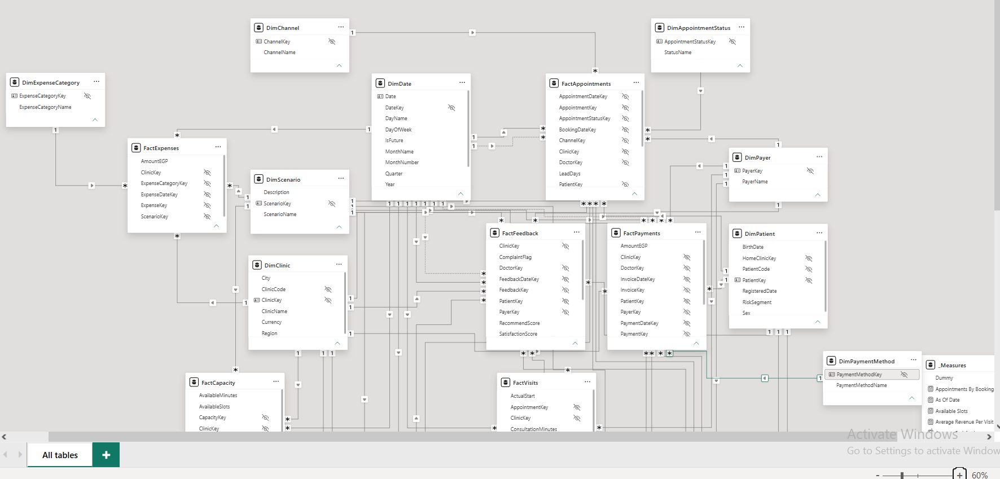
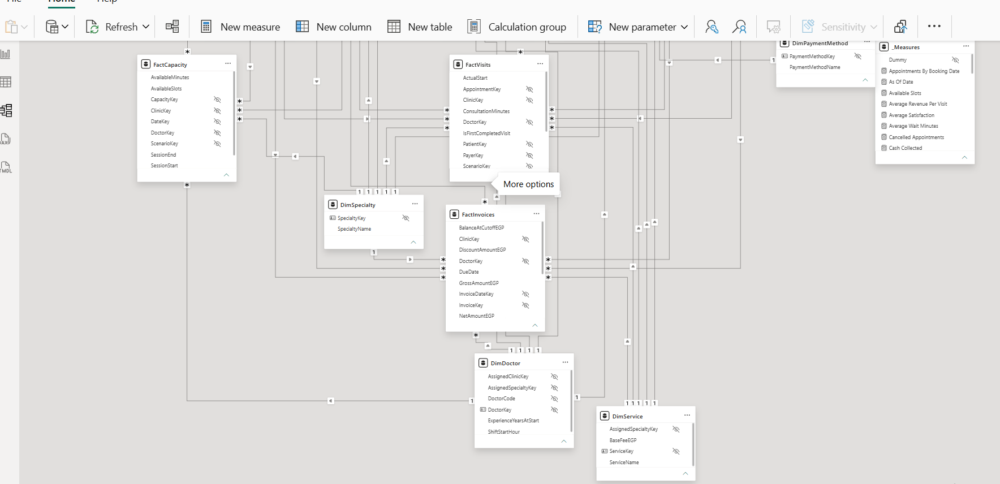
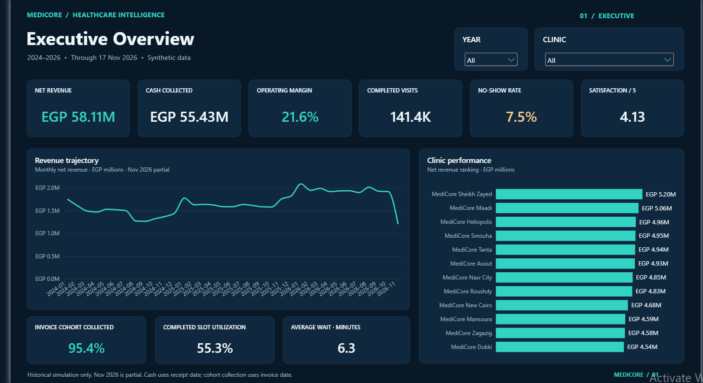
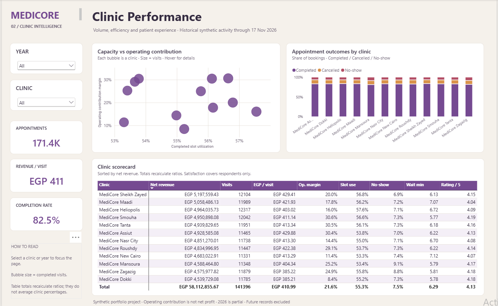
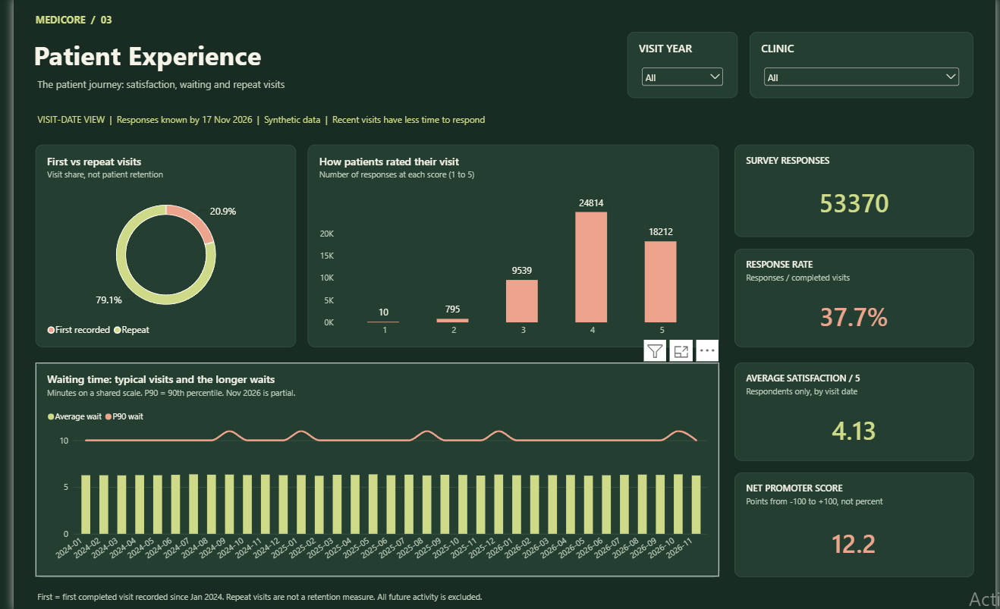

# MediCore Power BI Portfolio

MediCore is an advanced Power BI healthcare analytics portfolio project built with realistic synthetic data for a fictional 12-clinic network.

## Included

- `MediCore.pbix` — native Power BI report with Executive Overview, Clinic Performance, and Patient Experience pages.
- `MediCore_Three_Pages_Validated.zip` — self-contained package with the PBIX, PBIP source, CSV source data, documentation, and validation evidence.
- `PATIENT_EXPERIENCE_GUIDE_AR.html` — Arabic guide to metric definitions, assumptions, and verification.

## Data and model

The project uses fully synthetic data: 12 clinics, 60 doctors, 30,000 fictional patients, and approximately 180,000 appointments across 2024–2026. Historical activity is fixed through 17 November 2026. Records after that date are simulated future schedule, capacity, and planned expense data and are excluded from report pages.

The semantic model uses a multi-fact star schema, shared dimensions, 55 relationships, and 46 DAX measures across appointments, visits, invoices, payments, capacity, expenses, and feedback.

## Validation

- 102 source-data validation groups passed.
- 196 native Power BI model tests passed.
- 7,620 independent Patient Experience comparisons passed.
- PBIX archive integrity verified before release.

## Limitations

The data is synthetic and does not represent real patients, clinics, or clinical outcomes. Operating contribution is not accounting net profit. Repeat Visit Share is not patient retention. Satisfaction is based on survey respondents only. 2026 is a partial year.

## Portfolio wording

> Built a Power BI healthcare analytics portfolio solution for a fictional 12-clinic network using realistic synthetic data, a multi-fact dimensional model, 46 DAX measures, interactive executive, clinic performance, and patient experience pages, plus automated source-to-model reconciliation tests.

## Screenshots

### Data model

### Report pages

